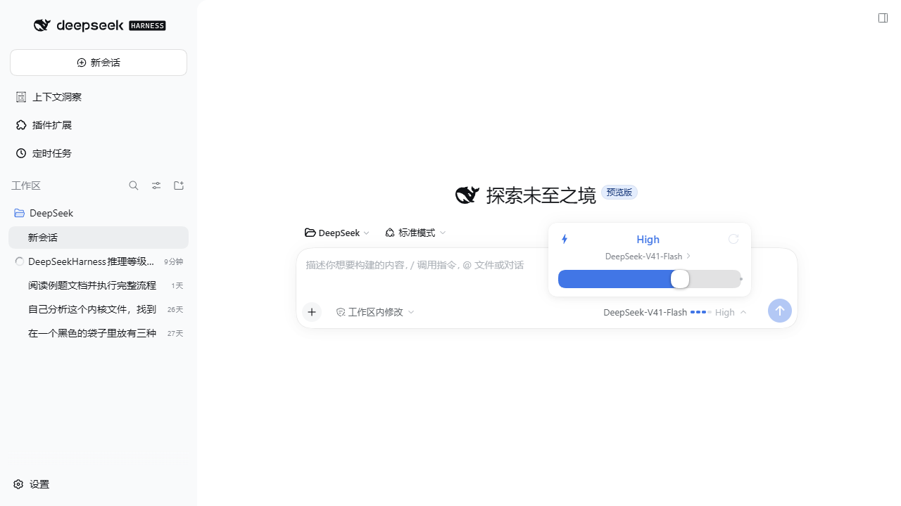
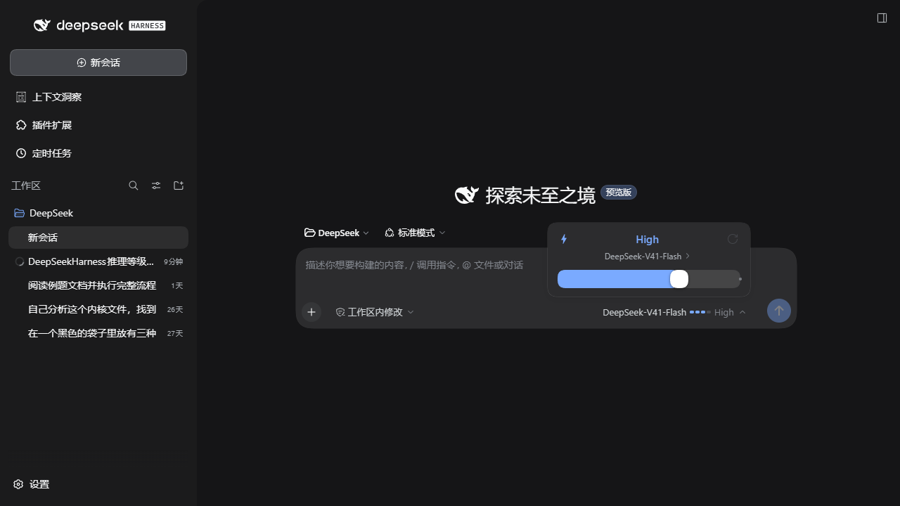
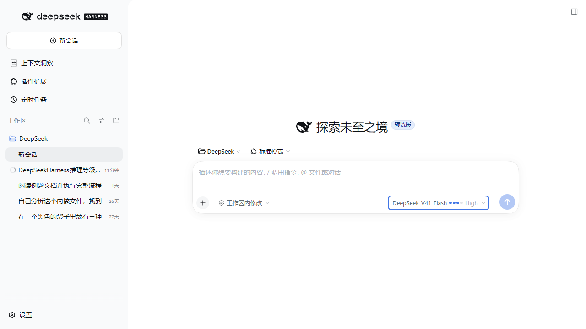

# dsh-reasoning-slider

把 DeepSeek Harness 输入框里的 **推理等级** 选择，从「点开二级菜单再点一行」改成一张 **卡片式滑块**。

| 浅色 | 深色 |
| --- | --- |
|  |  |

## 特性

- **滑块选档**：卡片底部一条轨道，蓝色填充 + 白色圆形滑块，未到达的档位用圆点标出。
- **三种操作方式**：拖拽滑块、点击轨道任意位置、键盘 `←` `→` `↑` `↓` / `Home` / `End`。
- **一键重置**：卡片右上角回到该模型的默认档；当前已是默认档时按钮置灰。
- **大字档位 + 说明**：卡片正中显示当前档位名称（`Off` / `Low` / `High` / `Max` …），下方是该档位的说明文字。
- **触发按钮上的刻度条**：不打开菜单也能一眼看出当前档位。
- **模型二级菜单保留**：分组、搜索、勾选、加载失败重试都在，只换成同一套卡片样式。
- **跟随明暗主题**：全部使用 DSH 设计令牌（`--dsw-alias-*`），浅色 / 深色自动适配；文案中英文自动切换。
- **不动官方插件**：官方 `ui-model-selection` 照常加载，它的 `modelDirectories` 服务和 `/model` 指令弹窗都能继续用。



## 安装

安装后 **刷新一次浏览器页面**（浏览器半边是在页面加载时注入的）。

### 方式一：插件页（推荐）

打开 DSH Web → **设置 → 插件 → 添加插件**，粘贴：

```
github:aci825223-ai/dsh-reasoning-slider
```

### 方式二：命令行

```bash
dsh plugin --profile <你的 profile 名> add github:aci825223-ai/dsh-reasoning-slider
```

也接受完整地址：`dsh plugin --profile <profile> add https://github.com/aci825223-ai/dsh-reasoning-slider`

装好后插件会出现在 **设置 → 插件 → 已安装** 列表里，开关默认打开。

### 方式三：本地源码（开发用）

把仓库克隆到任意位置，然后链接进 profile：

```powershell
git clone https://github.com/aci825223-ai/dsh-reasoning-slider
New-Item -ItemType Junction `
  -Path "$env:USERPROFILE\.dsh\profiles\<profile>\node_modules\dsh-reasoning-slider" `
  -Target "<克隆下来的目录>"
```

再在 `~/.dsh/profiles/<profile>/package.json` 里把包加进依赖和 bundles 列表：

```json
{
  "dependencies": { "dsh-reasoning-slider": "link:<克隆下来的目录>" },
  "dsh": { "profile": { "bundles": [ "…", "dsh-reasoning-slider" ] } }
}
```

正在运行的 DSH 会监听 profile 组合并自动重载，浏览器刷新即可看到效果。

## 卸载

设置 → 插件 → 已安装 → 关掉 **dsh-reasoning-slider** 的开关（或删除它），刷新页面即回到官方样式。

手动安装的话，从 profile `package.json` 的 `dsh.profile.bundles` 里删掉这一项，并删除
`node_modules\dsh-reasoning-slider` 链接。

## 工作原理

官方 `@deepseek-ai/dsh-client-ui-model-selection` 用默认优先级 `0` 占用了单占位槽
`conversation.input.model`。`dsh-client-ui-slots` 对同名单槽的规则是
**「同优先级重复注册直接报错，换一个优先级即可遮蔽，优先级最低者渲染」**，
所以本插件用 `priority: -1` 注册自己的组件，渲染权落到本插件，而官方那份仍然被加载，
其服务与指令不受影响 —— 不需要 `disabled: true` 去覆盖官方设置页。

数据全部来自占位槽注入的 props（`available` / `directory` / `load` / `select`），与官方组件一致；
写回同样走 `select({ provider, model, reasoningEffort })`。

### 两个坑（写同类插件的人可以抄）

- **必须声明 `remote` + `remote.session`**：`directoryFor()` 内部会访问 `ctx.remote.session` /
  `ctx.sessions`，而 Cordis 是按 **调用方** 的 inject 声明做访问检查的。漏声明会在渲染时报
  `cannot get property "remote.session" without inject`，并让该槽位条目直接崩溃。
- **浏览器半边不需要构建**：手写 CJS 包体即可，只要 `factory` 返回 `module.exports`：

  ```js
  window.__ModuleLoader__.load({ id: '<包名>', factory: (require) => { /* … */ return module.exports; } });
  ```

  本插件只 `require` 平台基线模块（`react`、`react/jsx-runtime`、`react-dom`、
  `@deepseek-ai/dsh-client-ui-primitives`），因此 `dsh.client.external` 为空。

## 文件

| 文件 | 作用 |
| --- | --- |
| `package.json` | 清单：`dsh.bundle.patch` + `dsh.client.platform: web` |
| `cordis.patch.yml` | 自挂载行（`id` 必须等于包名） |
| `lib/index.js` | 宿主半边（Web 端逻辑都在 client，这里只占位） |
| `lib/client.js` | 浏览器半边：locale、样式、滑块、模型二级菜单、槽位注册 |

## 常见问题

**装完没变化？**
浏览器半边在页面加载时注入，刷新一次页面（`Ctrl+R`）即可。不用重启 DSH 服务。

**控制台报 `cannot get property "remote.session" without inject`？**
inject 里补上 `remote` 和 `remote.session`，见上文「两个坑」。

**和别的插件抢同一个槽位？**
单占位槽同优先级重复注册会直接抛错，换个优先级（例如 `-1`）就能并存并遮蔽。

**档位和模型的组合对不上？**
档位来自当前模型自身的 `reasoning` 声明：不同模型的档位数量、名称、默认档都可能不同，
卡片上的档位名与说明文字都取该模型自己的定义。

## 开发

没有构建步骤：直接改 `lib/client.js`，刷新页面即可。改完后插件宿主会自动重载并更新资源版本号。

```bash
node --check lib/client.js   # 语法检查
node --check lib/index.js
```

## 兼容性

在 DSH `0.2.0-rc.2`（profile 名 `tauri`，Web 端）上开发并验证。插件不声明 `peerDependencies`、
不声明 `dependencies`，因此不会与 profile 里已有的运行时冲突。

验证记录见 [docs/verification.md](docs/verification.md)。

## English

`dsh-reasoning-slider` replaces the DeepSeek Harness composer's reasoning-effort picker with an
inline slider card: drag the thumb, click anywhere on the track, or use the arrow keys / `Home` /
`End`; the top-right button resets to the model's default effort. The model submenu (groups, search,
checkmarks) is kept in the same style. It shadows the shipped selector by registering into the
`conversation.input.model` single slot at `priority: -1`, so the official
`@deepseek-ai/dsh-client-ui-model-selection` plugin keeps working untouched. Install with
`dsh plugin --profile <name> add github:aci825223-ai/dsh-reasoning-slider`, then refresh the page.

## License

[MIT](LICENSE)
